# AriAja17

Software & Game Engineering student building games, mods, and the tools around them.

C++ and Java for game systems, TypeScript for web tooling, and small experiments in Godot and Unity.
Recent builds are Minecraft server tooling, a campfire overhaul mod, and small web apps.

## About

Hey! I’m a Software & Game Engineering student who’s passionate about game development. 
I’m currently learning and experimenting with different technologies while working on various designs and projects. AI has also become one of the tools I use to help turn my ideas into reality. 
Still learning, still building, and hopefully making something cool along the way. 
Nice to meet you!

## Loadout

**Game engines**

 

**Languages**

     

**Frontend**

    

**Backend**

  

**Database**

  

**Tools**

  

## Builds

<table>
<tr>
<td valign="top" width="50%">

**Now**

- Learning game systems in C++ and Java
- Maintaining Minecraft server tooling and a campfire overhaul mod
- Prototyping small web apps with TypeScript

</td>
<td valign="top" width="50%">

**Selected work**

<!-- builds start -->
- [campfireOverhaulPlus](https://github.com/AriAja17/campfireOverhaulPlus) - Fork Minecraft mod, Java
- [Afk-Bot-For-Minecraft-Server](https://github.com/AriAja17/Afk-Bot-For-Minecraft-Server) - Fork Minecraft server bot
- [KOTOWA](https://github.com/AriAja17/KOTOWA) - Japanese vocabulary web app, TypeScript
- [Kashi-No-Uta](https://github.com/AriAja17/Kashi-No-Uta) - song-meaning sharing site, TypeScript
- [pkl-web-POS](https://github.com/AriAja17/pkl-web-POS) - point-of-sale web app, TypeScript
<!-- builds end -->

</td>
</tr>
</table>

## Certifications

| Credential | Issuer | Issued | Verification |
| --- | --- | --- | --- |
| Credential name | Issuing body | YYYY-MM | Credential URL |
| Credential name | Issuing body | YYYY-MM | Credential URL |

*being worked on :>

## Stats

<!-- cool-readme:start -->
<!-- Cards by github-cool-readme: https://github.com/pedrocatalao/github-cool-readme -->

<picture><source media="(prefers-color-scheme: dark)" srcset="https://raw.githubusercontent.com/AriAja17/AriAja17/cards/summary-dark.svg?v=7"></picture><picture><source media="(prefers-color-scheme: dark)" srcset="https://raw.githubusercontent.com/AriAja17/AriAja17/cards/languages-dark.svg?v=7"></picture>

<picture><source media="(prefers-color-scheme: dark)" srcset="https://raw.githubusercontent.com/AriAja17/AriAja17/cards/contributions-dark.svg?v=7"></picture><picture><source media="(prefers-color-scheme: dark)" srcset="https://raw.githubusercontent.com/AriAja17/AriAja17/cards/streaks-dark.svg?v=7"></picture>

<!-- cool-readme:end -->

## Contact

